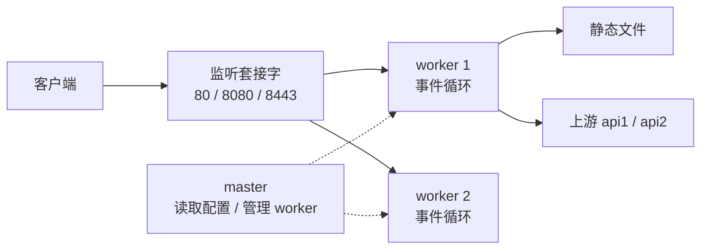

## nginx 的工作模型

这一章建立后面所有配置和排障都依赖的最小模型：**nginx 怎样接收连接、由谁处理请求、改配置后为什么可以平滑生效**。先把这几个问题弄清楚，后面看到 `worker_connections`、`reload`、`upstream` 时才不会只记住名字。

### 从一个并发问题说起

一个 Web 服务器要同时服务很多客户端。最直接的做法是“一个连接一个进程或线程”，实现简单，但连接数上升后，进程切换和内存开销会变得明显。nginx 选择的是**事件驱动**(event-driven)模型：少量工作进程配合事件循环，每个进程同时管理大量连接，只在连接可读、可写或发生错误时处理它。

这并不意味着 nginx 一定比所有服务器快，也不意味着进程越少越好。它意味着：**并发连接数不完全由进程数决定**，而是由工作进程数、每个进程的连接上限、文件描述符、上游响应速度和实际负载共同决定。

### master 与 worker

nginx 启动后通常有两类进程：

- **master 进程**：读取并校验配置、绑定监听端口、启动和回收 worker、处理信号。它不直接处理客户端请求。
- **worker 进程**：从共享的监听套接字上接受连接，运行事件循环，读取请求、访问静态文件或连接上游、写回响应。

主配置里的 `worker_processes auto;` 让 nginx 按 CPU 核心数决定 worker 数量。`events` 块里的 `worker_connections 1024;` 是**每个 worker** 的连接上限。客户端连接和到上游的连接都会占用文件描述符，所以实际能承载的并发还受 `worker_rlimit_nofile` 和操作系统限制影响。



图中实线是请求路径，虚线是管理关系。客户端连接由 worker 接受，master 不转发请求；多个 worker 可以共享同一个监听端口，由内核把新连接分给其中一个。

### 请求经过哪些步骤

一次普通的 HTTP 请求大致经过：

1. 客户端与监听端口建立 TCP 连接；如果是 HTTPS，先完成 TLS 握手。
2. worker 读取请求行和请求头，确定方法、URI、HTTP 版本和 `Host`。
3. 按“监听地址和端口 + `Host`”选择虚拟主机，也就是某个 `server` 块。
4. 在选中的 `server` 里按 URI 选择 `location`。
5. 执行该位置的 content 阶段：返回静态文件、执行 `return`、转发给上游，或交给其他模块。
6. 写回响应，并按 `access_log` 记录一行日志。

“选择 server”和“选择 location”是两个不同的问题。前者看连接落在哪个端口、请求的 `Host` 是什么；后者看 URI 怎样匹配。后面的配置模型和 `location` 章节会分别展开。

### 配置是一棵树

nginx 配置不是一串平铺的命令，而是有上下文的树：

```shell
main
├── events
└── http
    ├── upstream
    ├── map
    ├── server
    │   ├── location
    │   └── location
    └── server
```

常见指令的合法位置：

| 上下文 | 典型指令 | 作用 |
| --- | --- | --- |
| `main` | `user`、`worker_processes`、`error_log`、`pid` | 进程级设置 |
| `events` | `worker_connections`、`multi_accept` | 事件循环与连接 |
| `http` | `include`、`log_format`、`gzip`、`upstream`、`map` | HTTP 公共设置 |
| `server` | `listen`、`server_name`、`root`、`ssl_certificate` | 一个虚拟主机 |
| `location` | `try_files`、`proxy_pass`、`return`、`rewrite` | 一类 URI 的处理 |
| `upstream` | `server`、`least_conn`、`keepalive` | 一组上游节点 |

指令写错上下文时，`nginx -t` 会直接报 `directive is not allowed here`。这比运行时才发现问题好得多。

### 继承与覆盖

大多数指令会从外层继承到内层，直到内层重新定义。例如 `http` 里的 `gzip on;` 会作用于所有 `server`，除非某个 `server` 写了 `gzip off;`。

有一类行为容易误判：**`add_header` 不是追加，而是覆盖**。如果当前层级写了任何 `add_header`，它就不会再继承上一层的 `add_header` 列表。

```nginx
http {
    add_header X-From-Http "yes" always;

    server {
        add_header X-From-Server "yes" always;

        location / {
            # 这里只继承 X-From-Server，不会继承 X-From-Http
        }
    }
}
```

这也是实验配置里静态资源位置只写 `expires`、不写 `add_header` 的原因：避免把 `server` 级的安全响应头覆盖掉。nginx 1.29.3+ 提供了 `add_header_inherit merge;`，可以把上层与当前层的 `add_header` 合并；初学阶段先理解默认的覆盖模型，再按需使用新指令。

`include` 不是一种上下文，它只是把文件内容插入到当前位置。`include /etc/nginx/conf.d/*.conf;` 按文件名排序加载，但不要依赖多个 `server` 块之间的顺序来决定业务逻辑；需要“默认站点”时显式写 `default_server`。

### reload 到底做了什么

修改配置后执行：

```shell
nginx -t
nginx -s reload
```

`nginx -t` 检查语法和一部分文件依赖；`reload` 向 master 发送 `HUP` 信号。master 重新读取配置：

- 如果新配置校验失败，master 保留旧配置和旧 worker，继续服务。
- 如果校验通过，master 启动新的 worker，新连接由新 worker 处理；旧 worker 停止接受新连接，把手上的请求处理完后退出。

所以 reload 通常比 `restart` 平滑，客户端不会看到监听端口短暂消失。但 reload 不是万能的：长连接、WebSocket、正在传输的大文件会让旧 worker 存活更久；某些模块或证书文件的变化可能需要重启；配置校验通过也不代表上游一定可达。

`quit` 是优雅停止，`stop` 是快速停止：

```shell
nginx -s quit
nginx -s stop
```

在实验里，优先通过 Compose 管理容器，不要直接在容器里杀进程。

### 观察实验台

查看 nginx 实际加载的完整配置：

```shell
docker compose -f labs/compose.yaml exec nginx nginx -T
```

`-T` 会把主配置和所有 `include` 的文件一起打印出来，适合确认“我以为它读了这个文件，实际读的是哪个”。如果输出很长，可以重定向到文件再搜索：

```shell
docker compose -f labs/compose.yaml exec nginx nginx -T > /tmp/nginx-effective.conf
```

查看进程：

```shell
docker compose -f labs/compose.yaml top nginx
```

查看日志：

```shell
bash scripts/lab.sh logs nginx
```

### 常见误解

| 想法 | 实际是什么 | 怎么验证 |
| --- | --- | --- |
| nginx 每个请求开一个进程 | worker 用事件循环处理大量连接 | `docker compose top nginx` 只看到少量 worker |
| master 负责转发请求 | master 管理 worker，worker 处理请求 | 查看 `ps`/`top`，结合日志 |
| `worker_processes` 就是最大并发数 | 并发还受 `worker_connections`、文件描述符和上游影响 | 查看 `worker_connections` 与系统限制 |
| reload 等于重启 | reload 平滑替换 worker，旧 worker 会排空 | reload 前后观察 worker PID 与日志 |
| `server_name` 决定请求去哪个端口 | 先按监听端口建立连接，再按 `Host` 选 server | 用不同端口和 `Host` 请求对比 |

### 练习

- 运行 `docker compose -f labs/compose.yaml top nginx`，记录 master 和 worker 的数量。`worker_processes auto;` 在这台机器上会得到几个 worker？
- 运行 `docker compose -f labs/compose.yaml exec nginx nginx -T`，找出 `include` 进来的文件列表。主配置里的 `log_format` 最终出现在哪个上下文？
- 在 `labs/nginx/nginx.conf` 的 `log_format` 里临时加入 `pid=$pid`，reload 后请求首页，观察日志中的 PID 是否变化。这个实验说明了什么？
- 判断以下指令应该放在哪个上下文：`worker_connections`、`server_name`、`proxy_pass`、`upstream`、`gzip`。

<details>
<summary>参考答案</summary>

- worker 数量通常等于容器可见的 CPU 核心数。容器可能限制 CPU，因此不一定等于宿主机的物理核心数。`docker compose top nginx` 会列出 master 和 worker；worker 的具体数量以实际输出为准。
- `nginx -T` 会打印主配置和 `conf.d/*.conf`、`snippets/*.conf` 的内容。`log_format` 在 `http` 上下文；它定义的格式名被 `access_log` 引用。
- 加入 `$pid` 后，新请求会记录处理它的 worker PID。reload 后新 worker 的 PID 与旧 worker 不同；旧 worker 可能在一段时间内继续处理已有连接。这说明 reload 是“新旧 worker 交替”，不是原地修改一个进程。
- `worker_connections` 在 `events`；`server_name` 在 `server`；`proxy_pass` 在 `location`（也可在 `if` 等更窄的位置，但初学先记 location）；`upstream` 在 `http`；`gzip` 在 `http`、`server` 或 `location`。

</details>
