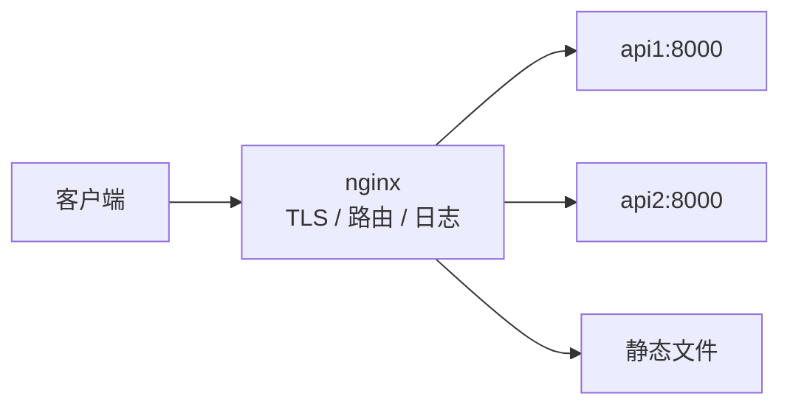

## 反向代理

反向代理让 nginx 站在客户端和应用之间：客户端只看见 nginx，nginx 把请求转给上游，再把响应带回来。它适合把静态资源、API、旧系统和新服务放在同一个域名下，也适合做 TLS 终止、统一日志和灰度入口。

### 正向代理与反向代理

| 类型 | 谁被代理 | 典型场景 |
| --- | --- | --- |
| 正向代理 | 客户端 | 公司网络出口、访问控制、缓存 |
| 反向代理 | 服务端 | 网站入口、API 网关、负载均衡、TLS 终止 |

本教程只讨论反向代理。客户端认为自己在和 nginx 通信；上游应用通常只监听内网地址，不直接暴露给公网。



### proxy_pass 的路径拼接

最容易出错的是 `proxy_pass` 后面有没有 URI、结尾有没有斜杠。先看实验配置：

```nginx
location /api/ {
    proxy_pass http://api1:8000/;
}
```

请求 `/api/users` 时，location 匹配到的前缀是 `/api/`，`proxy_pass` 的 URI 部分是 `/`，所以转发给上游的是 `/users`。

对照表：

| 配置 | 客户端请求 | 上游收到 |
| --- | --- | --- |
| `location /api/ { proxy_pass http://api1:8000/; }` | `/api/users` | `/users` |
| `location /api/ { proxy_pass http://api1:8000; }` | `/api/users` | `/api/users` |
| `location /api/ { proxy_pass http://api1:8000/v1/; }` | `/api/users` | `/v1/users` |
| `location = /api { proxy_pass http://api1:8000/; }` | `/api` | `/` |

记忆方法：**`proxy_pass` 带 URI 时，用 URI 替换 location 匹配到的部分；不带 URI 时，原样转发完整请求 URI。** 末尾斜杠决定替换后是否保留路径分隔。

如果上游路由需要 `/api` 前缀，就不要在 `proxy_pass` 末尾加 `/`；如果上游只认识 `/users`，就要加。两端必须对齐，不能靠猜。

### 转发头

上游应用通常需要知道真实客户端、原始协议和原始 Host。实验的共享片段：

```nginx
proxy_set_header Host              $host;
proxy_set_header X-Real-IP         $remote_addr;
proxy_set_header X-Forwarded-For   $proxy_add_x_forwarded_for;
proxy_set_header X-Forwarded-Proto $scheme;
proxy_set_header X-Forwarded-Host  $host;
proxy_set_header X-Forwarded-Port  $server_port;
```

| 头 | 作用 | 注意 |
| --- | --- | --- |
| `Host` | 上游看到的域名 | 默认是 `$proxy_host`（上游地址），通常要改成 `$host` |
| `X-Real-IP` | 单个客户端 IP | 只放一个值，适合简单场景 |
| `X-Forwarded-For` | 客户端和中间代理链 | `$proxy_add_x_forwarded_for` 会追加，不是替换 |
| `X-Forwarded-Proto` | 原始协议 | 上游生成绝对 URL 时需要 |
| `X-Forwarded-Host` | 原始 Host | 多域名入口时有用 |
| `X-Forwarded-Port` | 原始端口 | 容器内端口不一定等于宿主机端口 |

`X-Forwarded-For`（常缩写为 **XFF**）是可以被客户端伪造的。只有当你确认请求来自可信代理时，才应该使用它来判断客户端 IP。nginx 的 `real_ip` 模块可以配置可信代理范围：

```nginx
set_real_ip_from 10.0.0.0/8;
set_real_ip_from 172.16.0.0/12;
real_ip_header X-Forwarded-For;
real_ip_recursive on;
```

不要把 `set_real_ip_from` 配成 `0.0.0.0/0`，否则任何客户端都能伪造来源。上游应用同样要只信任来自 nginx 的转发头，不能直接相信公网请求里的 `X-Forwarded-For`。

### 超时、缓冲与流式响应

三个常用超时：

```nginx
proxy_connect_timeout 3s;   # 与上游建立连接
proxy_send_timeout    30s;  # 向上游发送请求
proxy_read_timeout    30s;  # 等待上游响应
```

它们和 `client_*` 超时不是一回事。`client_header_timeout`、`client_body_timeout` 管客户端；`proxy_*` 管上游。排查 504 时先分清是哪一段慢。

默认 `proxy_buffering on;` 会让 nginx 先缓冲上游响应，再发给客户端。这能提高吞吐、让慢客户端不拖住上游，但对以下场景不合适：

- **SSE**(Server-Sent Events, 服务器发送事件)
- 流式日志、进度条、大文件下载
- 需要逐块看到输出的接口

实验里的 `/api/stream` 关闭了缓冲：

```nginx
location = /api/stream {
    proxy_pass http://api1:8000/stream;
    proxy_buffering off;
    proxy_cache off;
    proxy_read_timeout 60s;
}
```

上游也可以返回 `X-Accel-Buffering: no` 让 nginx 关闭缓冲；实验 API 的 `/stream` 就设置了这个头。

`proxy_request_buffering off;` 则是另一件事：它让 nginx 边收客户端请求体边转发给上游，适合大文件上传或流式上传，但会改变错误处理和重试行为。

### 重试与错误映射

默认情况下，nginx 在连接失败或超时时可能尝试下一个上游。实验的负载均衡配置显式写了：

```nginx
proxy_next_upstream error timeout http_502 http_503 http_504;
proxy_next_upstream_tries 2;
proxy_next_upstream_timeout 10s;
```

注意：

- 对非幂等请求（例如扣款、下单）盲目重试可能造成重复副作用。是否重试要由业务语义决定。
- 重试会增加总耗时；`proxy_next_upstream_timeout` 是总预算，不是单次超时。
- 上游返回 500 通常不重试；502/503/504 才在配置里显式加入。
- `proxy_intercept_errors on;` 让 nginx 接管上游的 4xx/5xx，交给 `error_page` 处理；不需要自定义错误页时不要随便打开，否则上游的业务错误可能被改写。

常见状态码：

| 状态码 | 含义 | 先查什么 |
| --- | --- | --- |
| `502 Bad Gateway` | nginx 连不上上游，或上游提前断开 | 上游进程、端口、DNS、容器网络 |
| `504 Gateway Timeout` | 上游在超时内没有响应 | `proxy_read_timeout`、上游慢查询、线程/连接池 |
| `499` | 客户端在 nginx 返回前关闭连接 | 客户端超时、上游太慢；这是 nginx 日志里的状态码 |
| `500` | 上游自己返回 500 | 应用日志，不是 nginx 配置 |

### WebSocket 与连接升级

WebSocket 需要 HTTP/1.1 的 `Upgrade` 握手。主配置里已经定义了映射：

```nginx
map $http_upgrade $connection_upgrade {
    default upgrade;
    ''      close;
}
```

代理位置：

```nginx
location /ws/ {
    proxy_pass http://api1:8000/;
    proxy_http_version 1.1;
    proxy_set_header Upgrade $http_upgrade;
    proxy_set_header Connection $connection_upgrade;
    proxy_read_timeout 3600s;
}
```

`proxy_read_timeout` 要覆盖长连接的空闲时间，否则连接会被 nginx 主动断开。WebSocket 不适合开启 `proxy_buffering`。

### Docker 里的上游地址

Compose 网络里的服务名 `api1`、`api2` 由 Docker 内置 DNS 解析。nginx 在启动时解析 `upstream` 里的主机名；如果容器重启后 IP 变了，旧 nginx 可能仍拿着旧 IP，直到 reload。

处理方式：

- 简单实验：改完上游后 `bash scripts/lab.sh reload`。
- nginx 1.27.3+：在 `upstream` 里使用 `resolve` 参数，并配 `zone` 和 `resolver`，让 DNS 变化后自动重解析。
- 变量形式的 `proxy_pass` 也会触发运行时解析，但需要 `resolver`，并且会影响连接复用和部分优化。

实验为了保持配置简单，没有启用动态解析；生产环境要结合容器编排和服务发现选择方案。

### 实验

查看代理结果和转发头：

```shell
curl -i http://localhost:8081/api/
curl -s http://localhost:8081/api/headers
```

`/api/headers` 会返回上游看到的请求头。确认 `Host`、`X-Real-IP`、`X-Forwarded-For`、`X-Forwarded-Proto` 是否存在。

观察超时：

```shell
time curl -i http://localhost:8081/api/slow-timeout
```

请求会在大约 1 秒后返回 504，因为该 location 把 `proxy_read_timeout` 设成了 1 秒，而上游要睡 5 秒。

观察流式响应：

```shell
curl -N http://localhost:8081/api/stream
```

`-N` 关闭 curl 自己的缓冲。正常情况下大约每 0.5 秒出现一行。把 `10-proxy.conf` 里的 `proxy_buffering off;` 注释掉，reload 后再试，观察输出节奏的变化；实验结束后记得改回。

制造 502：

```shell
docker compose -f labs/compose.yaml stop api1
curl -i http://localhost:8081/api/
docker compose -f labs/compose.yaml start api1
```

停止 api1 后，代理入口连不上上游，返回 502，并显示自定义的 50x 页面。恢复 api1 后再请求一次，确认服务恢复。

### 练习

- `/api/users` 经过 `proxy_pass http://api1:8000/;` 后，上游收到什么路径？如果把末尾斜杠去掉呢？
- 为什么 `proxy_set_header Host $host;` 通常比默认的 `$proxy_host` 更适合 Web 应用？什么情况下需要保留原始端口？
- 客户端发送 `X-Forwarded-For: 1.2.3.4`，nginx 转发后上游看到什么？如果上游直接信任这个头，会有什么风险？
- 把 `/api/stream` 的 `proxy_buffering` 改为 `on`，观察输出变化。为什么 SSE 通常要关闭缓冲？

<details>
<summary>参考答案</summary>

- 带末尾斜杠时，`/api/` 被替换成 `/`，上游收到 `/users`；去掉末尾斜杠后，完整 URI `/api/users` 原样转发。两者要和上游路由约定一致。
- 上游通常按 `Host` 生成绝对链接、做虚拟主机路由或校验来源。默认的 `$proxy_host` 是上游地址（如 `api1:8000`），不是用户访问的域名。需要保留原始端口时用 `$http_host` 或显式加 `X-Forwarded-Port`；`$host` 通常会去掉端口。
- nginx 用 `$proxy_add_x_forwarded_for` 会把直接客户端地址追加到现有值后面，上游可能看到 `1.2.3.4, <真实地址>`。如果应用信任第一个值，就会把伪造的 `1.2.3.4` 当成客户端。正确做法是只信任来自已知代理的 XFF，并在 nginx 或应用层配置可信代理范围。
- 开启缓冲后，nginx 可能先攒够数据再发给客户端，流式输出会出现延迟或一次性到达。SSE 依赖逐事件推送，缓冲会破坏实时性，所以通常关闭 `proxy_buffering`，并让上游返回 `X-Accel-Buffering: no`。

</details>
